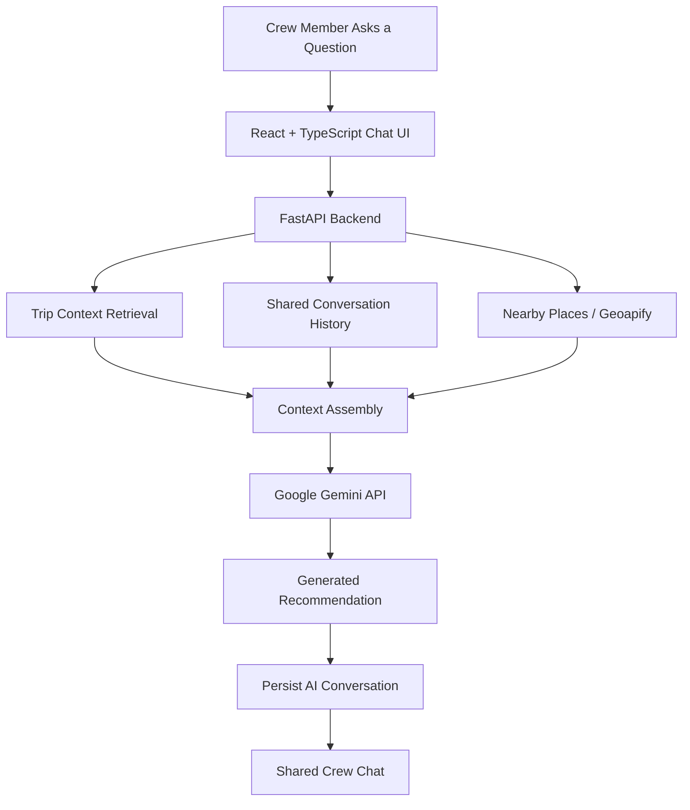
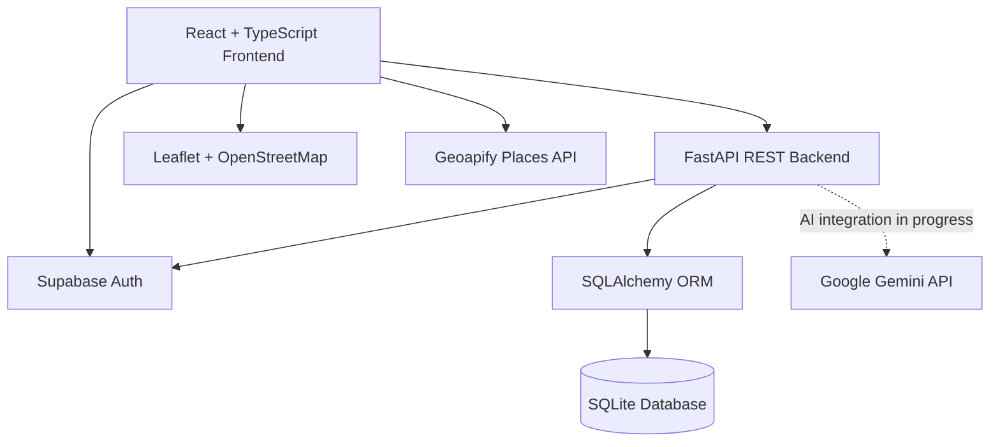

<div align="center">

# ✈️ OurViaggio

### The world is better explored together.

**An AI-Powered Collaborative Travel Planning Platform**

*Your group adventure, all in one place.*


**React · TypeScript · Python · FastAPI · SQLAlchemy · SQLite · Supabase · Gemini API · Leaflet · OpenStreetMap · Geoapify**

[View Source Code](https://github.com/EdlawitGide/gatherroute-trip-planner)

</div>

---

## 01. THE PROBLEM

### A trip planned across five different apps is a trip waiting for chaos.

I love traveling.

Exploring unfamiliar cities, discovering hidden cafés, trying new food, and making memories with friends are some of my favorite things.

But planning those adventures with a group?

**That's where things get complicated.**

Whenever I travel with friends, we usually find ourselves planning everything through iMessage, Apple Notes, and links scattered across different apps.

One person finds a hotel. Someone else sends restaurant recommendations. Another person suggests activities. Before we know it, important details are buried under hundreds of messages.

The itinerary lives in one place.

The hotel reservation lives somewhere else.

Expenses are being tracked separately.

And somehow, we're still asking:

> "Wait, what are we doing tomorrow?"

I kept thinking:

**Why can't everything just exist in one place?**

Are there already travel planning apps out there? Of course.

But I wanted to build something of my own, exactly how I imagined it.

Something collaborative, intelligent, and designed around how my friends and I actually travel.

So I started building **OurViaggio**.

---

## 02. THE SOLUTION

### One destination. One crew. One shared workspace.

OurViaggio is a full-stack travel planning application designed to centralize the group travel experience.

Instead of switching between multiple applications, travelers can collaborate within one shared trip workspace.

### Core Features

| Feature | Description | Status |
|---|---|---|
| 🔐 User Authentication | Account registration and login through Supabase Auth | ✅ Implemented |
| 👥 Travel Crew | Shared trip memberships and organizer-level permissions | ✅ Implemented |
| 🗓️ Trip Itinerary | Organize activities and coordinate plans | ✅ Implemented |
| 💸 Expense Tracking | Manage trip-related expenses | ✅ Implemented |
| 🗺️ Interactive Maps | Explore destinations using Leaflet and OpenStreetMap | ✅ Implemented |
| 📍 Nearby Places | Discover restaurants, cafés, hotels, and attractions using Geoapify | ✅ Implemented |
| 📅 Travel Dates | Update trip dates with backend validation | ✅ Implemented |
| 🔗 Account-Linked Memberships | Recover linked trip memberships across login sessions | ✅ Implemented locally |
| 🤖 AI Travel Recommendations | Gemini-powered travel assistance | 🚧 Integration being repaired |
| 💬 Shared AI Chat History | Crew-visible conversations with the AI assistant | 📋 Planned |
| 🧳 My Trips | View and switch between upcoming and past adventures | 📋 Planned |

**The goal isn't simply to organize a trip. It's to make planning together easier.**

---

## 03. THE AI VISION

### What if your travel assistant actually understood your trip?

Imagine you're traveling to Rome with your friends.

Your group has chosen a hotel near the Colosseum, and everyone is trying to figure out where to get breakfast.

Instead of opening multiple websites, reading dozens of reviews, and sending screenshots back and forth, imagine opening OurViaggio AI.

You ask:

> **"Based on our hotel location, what's a good place for breakfast nearby?"**

The goal is for OurViaggio's Gemini-powered assistant to combine the group's trip context with location information to generate relevant recommendations.

Not generic suggestions.

**Recommendations that make sense for your actual trip.**

### The intended AI experience

The assistant is being designed to consider:

- **Hotel location:** Where the group is staying.
- **Destination:** Which city or neighborhood they're exploring.
- **Trip dates:** When they're traveling.
- **Itinerary:** What activities are already planned.
- **Preferences:** What the group wants to experience.
- **Nearby places:** Restaurants, cafés, and attractions relevant to the request.
- **Conversation history:** What the group has already discussed.

### But here's the part I'm most excited about.

**AI conversations shouldn't belong to just one traveler.**

If one crew member asks for breakfast recommendations, everyone else should be able to see the response.

Another friend could ask:

> "Which of those places has vegetarian options?"

Someone else could follow up:

> "Which one is closest to our first activity?"

The conversation becomes part of the group's shared planning process.

**One assistant. One shared conversation. One evolving itinerary.**

### Planned AI Architecture



### Engineering Objectives

**Context-aware generation**

Construct model requests using structured trip details rather than relying on generic prompts.

**Location-grounded recommendations**

Use actual geographic context and nearby place information to support useful suggestions.

**Persistent conversation storage**

Store AI messages and responses in the application database.

**Collaborative conversation access**

Allow authorized trip members to see and continue conversations within their shared workspace.

**Secure API integration**

Keep model credentials on the backend and enforce appropriate access controls.

> **Development note:** Gemini integration has been started but is not currently working end-to-end. Context-aware recommendations and shared chat persistence are planned features. The architecture above represents the target implementation.

---

## 04. SYSTEM ARCHITECTURE

### Built with a modern, API-driven full-stack architecture.

OurViaggio separates the client interface, backend application logic, persistent database, authentication provider, and external integrations.



### Technology Stack

| Layer | Technology | Purpose |
|---|---|---|
| **Frontend** | React | Component-based user interface |
| **Language** | TypeScript | Typed frontend application logic |
| **Styling** | CSS | Custom responsive UI and branding |
| **Build Tool** | Vite | Development server and frontend builds |
| **Backend Language** | Python | Server-side application logic |
| **API Framework** | FastAPI | RESTful API endpoints |
| **ORM** | SQLAlchemy | Relational database models and queries |
| **Database** | SQLite | Persistent trip, membership, and planning data |
| **Authentication** | Supabase Auth | Signup, login, and session management |
| **AI Integration** | Google Gemini API | Planned contextual travel assistance |
| **Mapping** | Leaflet | Interactive mapping components |
| **Map Tiles** | OpenStreetMap | Geographic map visualization |
| **Places API** | Geoapify | Restaurants, hotels, cafés, and attractions |
| **API Communication** | REST / JSON | Frontend-backend communication |
| **Version Control** | Git + GitHub | Code management and project history |

---

## 05. ENGINEERING HIGHLIGHTS

### 5.1 Authentication Is Not Authorization

One of the more challenging parts of development was connecting Supabase authentication with the application's existing trip-membership system.

Supabase handles user identity.

FastAPI manages trip membership and permissions.

These are related—but not identical—responsibilities.

Initially, a returning user could be authenticated with Supabase but still be treated as a new trip member.

That created duplicate membership records.

To address this, I implemented account-linking functionality that associates existing trip memberships with verified Supabase user identities.

### Account-Linking Workflow

```text
User signs in
      |
      v
Supabase authenticates user
      |
      v
Frontend receives authenticated session
      |
      v
FastAPI verifies Supabase access token
      |
      v
Backend finds or links trip membership
      |
      v
Existing membership is recovered
      |
      v
User returns to their trip workspace
```

The implementation preserves existing membership records and supports account-based recovery across login sessions.

This functionality has been tested locally. Additional authorization hardening and edge-case testing are planned before production deployment.

### 5.2 Relational Database Design

OurViaggio uses **Python, SQLAlchemy, and SQLite** to manage persistent application data.

The backend models trip-related entities and their relationships, including:

- Trips
- Members
- Activities
- Shared planning information
- Expenses

Using a relational database allows the application to associate trip information with the relevant participants while preserving shared state.

### 5.3 RESTful API Development

The application backend is built with **FastAPI**.

It provides endpoints for trip creation, joining workspaces, retrieving trip data, managing members, and updating travel information.

Example API routes:

```http
GET /api/trips/{code}
POST /api/trips/{code}/join
PATCH /api/trips/{code}/dates
POST /api/trips/{code}/claim
GET /api/trips/{code}/membership
GET /api/my-trips
DELETE /api/trips/{code}/members/{member_id}
```

The backend also performs validation and manages persistent state through SQLAlchemy.

### 5.4 Geospatial Discovery

The Explore Map integrates:

- **Leaflet** for interactive map rendering.
- **OpenStreetMap** for map tiles.
- **Geoapify Places API** for location-based discovery.

Users can explore restaurants, cafés, hotels, and attractions while planning their trip.

This also creates a foundation for the future AI recommendation system.

### 5.5 Collaborative Trip Management

OurViaggio is designed for groups rather than individual users.

The shared workspace supports multiple members working with the same trip information.

This introduces engineering considerations around:

- Membership identity
- Organizer-level permissions
- Shared data persistence
- Backend validation
- Protecting historical records
- Keeping collaborative information consistent

---

## 06. PROJECT STRUCTURE

Key application files and directories:

```text
gatherroute-trip-planner/
│
├── backend/
│   ├── app/
│   │   └── main.py
│   ├── requirements.txt
│   └── .env                 # Local configuration, not committed
│
├── frontend/
│   ├── public/
│   │   └── ourviaggio-icon.png
│   │
│   ├── src/
│   │   ├── App.tsx
│   │   ├── AuthGate.tsx
│   │   ├── ExploreMap.tsx
│   │   ├── api.ts
│   │   ├── geo.ts
│   │   ├── supabase.ts
│   │   ├── auth.css
│   │   ├── styles.css
│   │   └── main.tsx
│   │
│   ├── package.json
│   └── .env.local           # Local configuration, not committed
│
└── README.md
```

---

## 07. GETTING STARTED

### Prerequisites

- Python 3
- Node.js and npm
- A Supabase project
- A Geoapify API key

Gemini credentials will also be required for AI features once the integration is restored.

### Clone the repository

```bash
git clone https://github.com/EdlawitGide/gatherroute-trip-planner.git
cd gatherroute-trip-planner
```

### Backend Setup

```bash
cd backend

python3 -m venv .venv
source .venv/bin/activate

pip install -r requirements.txt
```

Create a file named `backend/.env`:

```env
SUPABASE_URL=your_supabase_project_url
SUPABASE_PUBLISHABLE_KEY=your_supabase_publishable_key
```

Start the FastAPI server:

```bash
uvicorn app.main:app --reload
```

### Frontend Setup

Open another terminal:

```bash
cd frontend
npm install
```

Create a file named `frontend/.env.local`:

```env
VITE_SUPABASE_URL=your_supabase_project_url
VITE_SUPABASE_PUBLISHABLE_KEY=your_supabase_publishable_key
VITE_GEOAPIFY_API_KEY=your_geoapify_api_key
```

Start the frontend:

```bash
npm run dev
```

Open the URL provided by Vite, typically:

**http://localhost:5173**

### Security Notes

- Never commit `.env` files.
- Keep private API keys out of frontend source code.
- Never expose Supabase service-role credentials.
- Do not commit local SQLite databases containing user information.
- Backend authorization should be fully hardened before public deployment.

---
